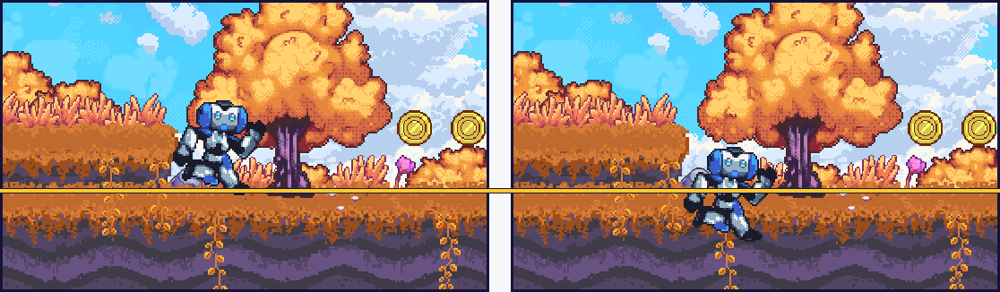
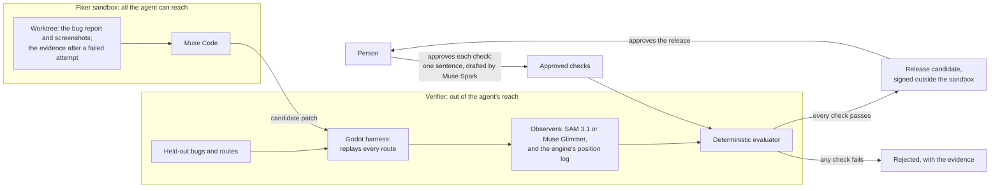

# Expectrail

**An AI coding agent says it fixed the bug. Expectrail plays the game and watches to find out.**

[expectrail.com](https://expectrail.com) · [Interactive demo](https://expectrail.com/demo/) ·
[A rejected fix, frame by frame](https://expectrail.com/review/sinking-fix/)



**Left, accepted:** Muse Code's fix, written from a plain bug report. **Right, rejected:** the same
line, plus one that draws the robot lower than its body. Both stop the fall; the engine's position
log and Muse Code's own screenshot review accept both. Real frames from the recorded reviews
([left](docs/review/report-first-run-1/), [right](docs/review/sinking-fix/)); the yellow line is
drawn here at the floor's edge, the verdicts are the runs' own.

<!-- The demo video's link goes first in the box below once it is uploaded. -->
> **For judges: the whole project in three minutes**
>
> 1. **Two fixes for the same bug.** Both stop the robot falling through the floor. One of them does
>    it by drawing the robot inside the floor. The engine's position log accepts both. Muse Code,
>    shown the before-and-after screenshots, accepts both. Expectrail rejects the fake one, because
>    SAM 3.1 sees the robot's feet below the floor's edge.
>    [Real frames, before and after](docs/review/sinking-fix/)
>    ([live page](https://expectrail.com/review/sinking-fix/)); a real fix from a live overnight run,
>    failing before and passing after: [report-first-run-1](docs/review/report-first-run-1/).
> 2. **The same question, asked fifteen times.** Seven fixes that only look right and eight correct
>    ones, each given to three judges, in three runs. Expectrail with SAM accepted 0 of the 7 and all
>    8 of the 8, every run. The position log alone let 3 of the 7 through; Muse Code from screenshots
>    let 2 through and turned down correct ones. [The table](#who-catches-a-fix-that-only-looks-right).
> 3. **Where it is weak, measured.** On single edits nobody wrote, the checks caught 10 of 77; there
>    is no blind catch on a real-world bug yet; it replays fixed routes and does not explore. Every
>    number has the CI run behind it. [Results](#results) ·
>    [What Expectrail cannot do yet](#what-expectrail-cannot-do-yet).
> 4. **Run it with no keys, in seconds:** `python3 -m pip install -r requirements-dev.txt`, then
>    `python3 -m agents.loop --out runs/loop --mode offline --runs 1` (fixtures, labelled as such;
>    a real replay needs Linux and Godot: [Try it](#try-it)).
> 5. **Which Meta model does what:** [Meta models](#meta-models). Seven are used; none of them
>    decides whether a change passes.

## The problem

Coding agents now change code faster than anyone can review it. The gate everyone relies on, "the
tests pass", checks only what someone already wrote a test for, and the bugs that matter most are
the ones nobody anticipated. Ask the agent whether its own fix worked and it grades its own
homework. It believes in exactly the fixes that matter most, the ones that only look right: shown
before-and-after screenshots of a fix that draws the robot inside the ground, Muse Code said the
fall was fixed.

Games show the gap most plainly. A change can pass every test and still be visibly broken: a robot
falling through the floor, coins that are not drawn, a character hidden behind trees. The demo game
we use ships with no tests at all, so existing checks catch none of our seeded bugs, and most of
what goes wrong shows only on screen. That is why we built and measured on a game first. Our first
users would be teams that let coding agents change code their tests do not cover, starting with
game studios, where that gap is widest. Expectrail fits into the pipeline they already have as one
more gate; it does not replace their CI, their tests or their QA.

## The idea: verify by observation, not by trust

Expectrail is an independent verification layer for changes made by AI agents. The agent that
writes a change never certifies it. Three rules carry that:

1. **Evidence comes from running the changed software and watching it**, not from the diff or the
   agent's account of it. A harness replays a fixed route through the game and captures every
   frame, the same way every time.
2. **Models observe; plain code decides.** Meta's vision models (SAM 3.1, or the open-weight Muse
   Glimmer) find what a plain-English check names in the frames. The engine logs where the robot,
   the coins and the floor really are. A deterministic evaluator measures one against the other,
   and against the clean game, and accepts the change only if every check passes. A missing or
   uncertain observation is "needs review", never a pass.
3. **The agent cannot reach the judge.** The checks are written by people and approved once (Muse
   Spark drafts one from a sentence; the ground check started from its draft, tightened by hand).
   They live outside the fixer's sandbox, with the held-out routes and the key that signs a
   release. The fixer sees a failing check's spec only after a failed attempt, and never sees the
   held-out ones.

Built for the Meta Global AI Developer Hackathon (Indie track), October 26 to November 4, 2026.
Expectrail was called Nightshift until October 30; the old names still work wherever a file or
setting from before then turns up ([`expectrail/legacy.py`](expectrail/legacy.py)).

## What it shows

Each claim below has a run behind it; the full tables, with limits, are under [Results](#results).

- **It rejects fixes that only look right.** Given a "fix" that stops the robot falling through the
  floor by drawing it sunk into the ground, a position-only check passed it, and Muse Code, shown
  the before-and-after screenshots, said the fall was fixed. Expectrail saw the robot's feet below
  the floor and rejected it. In the judge benchmark, with SAM, it accepted none of the 7 fixes that
  only look right and turned down none of the 8 correct ones, in all three runs
  ([the table](#who-catches-a-fix-that-only-looks-right)).
- **The verifier is where it wins, not the fixer.** Muse Code fixes most bugs from a plain report:
  on October 29 it fixed all 8 development bugs from screenshots alone, as well as with our
  evidence. What screenshots cannot do is judge. So the loop as it ships gives the fixer a plain
  bug report first, verifies every attempt, and sends Expectrail's evidence to the fixer only after
  a failed one ([docs/report-first.md](docs/report-first.md)). The evidence still matters on the
  subtle bugs: on October 31 it fixed both sinking bugs on the first attempt, where the report
  alone timed out.
- **We tried to break it, and wrote down where it broke.** A mutation bench, registered before any
  case was judged, made 47 candidate fixes with six operators: the checks caught 31 of the 39 that
  are wrong and accepted all 8 that are right; the 8 misses are one operator that changed nothing
  in the running game. On single edits nobody wrote it is weak: weighted by how common each kind of
  edit is, it caught 0.9% of those that differ from the clean game, because it caught none of the
  45 that move, resize or re-layer something, 44 of them scenery no check covers (10 of 77 over the
  sample as drawn). Given the 10 it caught, Muse Code fixed every one correctly on its first
  attempt ([`bench/mutation/`](bench/mutation/README.md#results)).
- **Every fix is reviewed against its failing base.** The same checks run on the game with the bug
  and on the game with the fix, so a report shows the requested behaviour failing before and
  passing after, not only passing. In six live overnight runs on October 30 and 31, each Muse Code
  fix was a demonstrated repair, and the fix that sinks the robot was rejected with its requested
  checks still failing ([docs/review.md](docs/review.md)). Reviews with real frames:
  [report-first-run-1](docs/review/report-first-run-1/) (the loop as it ships),
  [live-demo-run-1](docs/review/live-demo-run-1/) (the evidence given first), and the rejected
  [sinking-fix](docs/review/sinking-fix/).
- **The same engineering carries to a second kind of software.** To see whether the design is
  about games or about verification, we pointed the same verifier at a web checkout page, with
  Chromium in place of the game engine and the page's layout boxes in place of the position log.
  With SAM it caught 8 of 8 seeded bugs and 4 of 4 private ones, accepted none of 5 changes that
  only look right, and accepted all 16 of Muse Code's live repairs
  ([Beyond games](#beyond-games-a-web-checkout-page)).
- **It has started to look for problems nobody wrote a check for.** Human-written checks are the
  gate. Since October 31, advisory discovery also replays 22 generic probes and judges each replay
  against rules read from the game's own code, reporting only what fails three times out of three.
  It found all four reproduced public bug reports with no false alarm on the clean game, but its
  rules were written after we read those reports, so that is a development result. Blind, on two
  sets of fresh entries written after it was frozen, it flagged 7 of 16 defects and none of the 4
  intentional changes. Discovered checks advise; only the human-written ones can reject a change
  ([Two kinds of checks](#two-kinds-of-checks)).

## How it works



Five steps. Models do the looking and the fixing; plain code makes every decision.

1. **Play.** A harness replays a fixed route through the game and captures every frame, the same
   way every time (ten replays, bit-identical).
2. **See.** Muse Spark turns a plain-English check ("the player never falls through the ground")
   into a structured test spec that a person approves once. SAM 3.1 (or Muse Glimmer) finds the
   objects the spec names in the frames, and the engine logs where they really are.
3. **Decide.** A deterministic evaluator, not a model, compares the two and decides pass or fail. A
   missing or uncertain observation is "needs review", never a pass.
4. **Fix.** Muse Code gets what a developer would get, and nothing the judge keeps private:
   - **The first attempt gets a plain bug report:** the failing check's sentence, screenshots of
     the failing run, the route and its log.
   - **A failed attempt earns the evidence.** If the verifier rejects the attempt, or it produces
     no fix in time, the next one gets the spec, the verdict, the first failing frame and which
     public checks failed. Never anything about the held-out routes. Muse fixes most bugs from the
     report alone, but on October 31 it timed out on both sinking bugs until it had the evidence
     ([docs/report-first.md](docs/report-first.md)).
   - **It works in a sandbox.** Muse patches the game in its own worktree. In the live runs that
     worktree is the only thing mounted inside bubblewrap (its project config read-only, an empty
     home), so the verifier's code, the held-out cases and the signing key are not in its
     filesystem at all. Since October 30 it has no network of its own: its only way out is the key
     gateway, which reaches Meta's API (`*.meta.ai`) and holds the key
     ([docs/obaaf.md](docs/obaaf.md)). Bubblewrap is a namespace sandbox on the host's kernel, not
     a VM; where it is not available, the fixer falls back to a worktree that does not contain
     those files.
5. **Verify and hand over.** A separate verifier rebuilds, replays, and runs the regression,
   gameplay, held-out and clean checks on every attempt. It accepts a candidate only if every
   check passes, so a fix that only looks right, such as one that stops the fall by drawing the
   robot inside the ground, is rejected with its evidence. What a person then gets: before-and-after
   frames, the diff, unresolved cases, and a release candidate signed outside the fixer's reach.
   It can run overnight; the point is the sign-off, not the hour.
   - **When the judge cannot answer, nobody wins by default.** Before anything is spent, one image
     checks that SAM answers; if it does not, the run stops before the fixer. If SAM stops
     answering later (down, or out of credit), the same fix is judged again: by SAM once more
     (unless the key was refused or is out of credit), then by Muse Glimmer checked against the
     engine, labelled as such, then left for a person. A rejection is never sent to a second judge,
     an outage never costs the fixer an attempt, and the review against the failing base uses
     whichever judge decided ([docs/fallbacks.md](docs/fallbacks.md)).

**Feedback goes in, but never straight to the fixer.** Muse Voice Transcribe turns a recorded
playtest into who-said-what. When Muse Spark sorts a remark as a bug and writes a one-line check
for it, that becomes a draft test spec that waits for a person's approval; raw speech never becomes
a spec. A request to weaken or switch off a check ("just turn the floor check off") is refused and
queued for a person, whether the fixed phrase rules or the model catch it. Inside the fixer, a
Muse Code hook blocks file-tool writes outside the editable files and logs every tool call (shell
commands are logged, not checked). The morning report lists both under "Feedback in" and "Refused
or blocked".
[docs/feedback-recording.md](docs/feedback-recording.md)

### Meta models

Seven Meta models look, write and fix; six have run live. None of them decides whether a change
passes: plain code does, from what they observe.

| Model | Its job | Shown by |
| --- | --- | --- |
| SAM 3.1 | Finds what a check names in each frame it judges: the robot, the coins, a checkout button | With SAM, 0 of 7 fake fixes accepted, against 3 of 7 without it; 24 of the 31 machine-made wrong fixes caught were caught only with SAM ([Results](#results)) |
| Muse Code | The fixer, in a sandbox where it cannot change the checks and never sees the hidden ones | Fixed the bug from a plain report on the first attempt in 3 of 3 live runs ([41223748922](https://github.com/seanudeke/Expectrail/actions/runs/41223748922)) |
| Muse Wonder | Triage: turns failure evidence into a bug report and a repair request | Every overnight-loop run ([bench/demo-loop](bench/demo-loop/README.md)) |
| Muse Spark | Drafts a check from one sentence for a person to tighten and approve; sorts playtest remarks; proposes discovery probes | The ground check started from its draft ([bench/spec-writer-live](bench/spec-writer-live)); blind, the discovery planner added one defect to the templates' three on a set of eight |
| Muse Glimmer 30B, open weights | Judges the vision checks with no SAM key, checked against the engine; the fallback when SAM does not answer | 8 of 8 held-out bugs caught with Glimmer in place of SAM; the four that need vision were caught by its checks ([docs/open-weights.md](docs/open-weights.md)) |
| Muse Spark Open, open weights | Drafts checks and sorts playtest remarks, served on Baseten | [bench/spark-open](bench/spark-open) |
| Muse Voice Transcribe | Turns a recorded playtest into who said what | Built, not yet run live: CI uses a recorded transcript ([docs/feedback-recording.md](docs/feedback-recording.md)) |

### Two kinds of checks

| | Written by people | Discovered by Expectrail |
| --- | --- | --- |
| What | Three approved specs (the robot stays above the ground, the robot is visible, the coins are visible), the gameplay check, and the held-out bugs and routes. Five engine-record checks for the reported bugs, run by their bench, not by the verifier | 22 generic probes (stand still, walk each way, reverse, jump once, twice or eight times from four spots, shoot at two rates each way, walk while firing), judged by contracts built from a profile of four claims read from the game's code: the double jump, the gun's cooldown, the sprite's facing, the enemies' patrol |
| Who writes them | Muse Spark drafts a spec from one sentence, a person approves it; teammates write the held-out cases | Twelve templates, with no model. Muse Spark can propose more probes and contracts in a closed language (built; its first live calls returned no content); a proposal never approves itself |
| Effect | The gate: any failure rejects the change | Advisory: reported beside the decision, never changing it |
| Shown so far | 8 of 8 held-out bugs caught with SAM; 0 of 7 fixes that only look right accepted | Blind, two fresh sets: 7 of 16 defects flagged, no false alarm on 4 intentional changes or the clean game; with the Muse Spark planner on set 2, 4 of 8 instead of 3. Development: the four reported bugs found, no false alarm (its profile was written after them); 2 of the 8 development bugs |
| Next | More approved checks; the engine-record checks in the verifier | A larger blind set written by people; then validation, a person's approval and paired verdicts before a discovered check can reject anything ([docs/discovery.md](docs/discovery.md#whats-next)) |

Status, October 30: the whole loop runs live, end to end: Wonder triage, Muse Code in a sandbox,
the Godot harness, the verifier with SAM 3.1 on the private held-out routes, the signed morning
report and the trust check. See [docs/new-work.md](docs/new-work.md) and
[agents/demo-path.md](agents/demo-path.md). Since October 31, advisory discovery runs beside it in
CI ([docs/discovery.md](docs/discovery.md)).

## Results

Every number here comes from a file in [`bench/`](bench), written from a CI run's own output, with
the command that reruns it; the one exception, Meta API spend, comes from the team's usage export.
Read the table as three questions: does it catch the bug (detection), does it reject a fix that
only looks right (the judge), and does the whole loop run live (the demo path).

The cases: four bug families (physics fall-through, missing texture, layering, sinking), with two
public development variants and two private held-out variants of each; the detection benches
replay every variant, and the clean game, on five routes. We wrote those bugs; four more reproduce
bugs other people reported ([Bugs we did not write](#bugs-we-did-not-write)), and the mutation
bench generates its own ([`bench/mutation/`](bench/mutation/README.md)).

| What we measured | Result | Run |
| --- | --- | --- |
| Held-out bugs caught, SAM 3.1 on | **8 of 8**, no false alarm on the clean game | [41003749744](https://github.com/seanudeke/Expectrail/actions/runs/41003749744) |
| Held-out bugs caught, Muse Glimmer checked against the engine, no SAM | **8 of 8**, no false alarm | [41003751876](https://github.com/seanudeke/Expectrail/actions/runs/41003751876) |
| Held-out bugs caught with no vision model (engine and gameplay checks only) | 4 of 8 | the same two runs |
| Development bugs caught: SAM on / Glimmer, no SAM / no vision | 8 of 8 / 8 of 8 / 3 of 8 | [40841977642](https://github.com/seanudeke/Expectrail/actions/runs/40841977642), [41001182605](https://github.com/seanudeke/Expectrail/actions/runs/41001182605) |
| Publicly reported Godot bugs, reproduced (not written by us), caught: today's checks with SAM off / engine-record checks | 0 of 4 / **4 of 4**, no false alarm on the clean game; the engine-record checks were written after the bugs were reproduced | [41116202685](https://github.com/seanudeke/Expectrail/actions/runs/41116202685) |
| Advisory discovery (checks nobody wrote), one job per build, no reference build: the clean game, the four reported bugs, and the eight development bugs it was not written for | Reported bugs **4 of 4** found, each 3 times out of 3, no false alarm on the clean game; development bugs 2 of 8. Development reproduction: its rules were written after reading the four reports | [41238187197](https://github.com/seanudeke/Expectrail/actions/runs/41238187197) |
| Advisory discovery, blind: the frozen discoverer on two fresh sets written after its freezes (8 defects and 2 intentional changes each) and the clean game, planner off | **7 of 16** defects flagged (4 of 8, then 3 of 8), each finding 3 times out of 3; **no** intentional change or clean game flagged; no job incomplete | [41248745687](https://github.com/seanudeke/Expectrail/actions/runs/41248745687), [41319184209](https://github.com/seanudeke/Expectrail/actions/runs/41319184209) |
| The same, set 2, with the Muse Spark planner on (the clean game as each job's reference) | **4 of 8** defects flagged, one more than without it; **0 of 3** healthy builds flagged | [41319197682](https://github.com/seanudeke/Expectrail/actions/runs/41319197682) |
| Natural-catch trial: Muse Code given each reported bug in the reporter's words, 5 times each (20 cases) | 20 of 20 fixed on the first attempt; Expectrail accepted 20, the bug's own check passed 20, Muse from screenshots accepted 19; **0 natural catches** | [41129722699](https://github.com/seanudeke/Expectrail/actions/runs/41129722699) |
| Bad fixes that only look right, accepted by the judge (7 cases, 3 runs) | Expectrail with SAM **0 of 7**; Expectrail without SAM 3 of 7; Muse from screenshots 2 of 7; Expectrail with Muse Glimmer checked against the engine, no SAM (1 run) 0 of 7, one of them stopped only on a held-out route | [judge](bench/judge/README.md), [with Glimmer](bench/judge/glimmer/README.md) |
| Good fixes accepted by the judge (8 cases, 3 runs) | Expectrail 8 of 8 every run, with Glimmer too; Muse from screenshots 6, 7 and 6 of 8 | [judge](bench/judge/README.md), [with Glimmer](bench/judge/glimmer/README.md) |
| The same 15 fixes judged from screenshots by the strongest outside models, Claude Fable 5.1 and GPT-6 Astra (1 run, 3 passes each, the same frames and prompt as Muse) | Bad fixes accepted: **0 of 7** in every pass, both. Good fixes accepted: Claude 6, 6 and 7 of 8; GPT 8, 7 and 8 of 8 | [outside models](bench/judge/outside-models/README.md) |
| Mutation bench, wrong fixes: 47 candidates made by six operators the team wrote, registered before judging, public checks only | Tiered judge **31 of 39** bad fixes caught (79.5%), 24 of them only with SAM; 8 good cases accepted. The 8 misses are one operator that changed nothing in the running game | [41268021760](https://github.com/seanudeke/Expectrail/actions/runs/41268021760), [record](bench/mutation/README.md#results) |
| Mutation bench, bugs nobody wrote: 150 sampled single edits to the game, 77 of them different from the clean game in positions or frames, registered before judging, public checks only | Weighted score **0.9%**, set by the numeric class, 0 of 45 caught: 44 edits to scenery no check covers, and one that draws the player's sprite 26 px off its body. Over the sample as drawn, a figure about the sample: 10 of 77 caught (13.0%), 5 only with SAM | [41268023631](https://github.com/seanudeke/Expectrail/actions/runs/41268023631), [41323827584](https://github.com/seanudeke/Expectrail/actions/runs/41323827584), [41323829361](https://github.com/seanudeke/Expectrail/actions/runs/41323829361), [record](bench/mutation/README.md#results) |
| Mutation bench, AI-written fixes: Muse Code on the 10 generated bugs the checks caught, from a report built mechanically from the failing check, with the route and screenshots | 10 of 10 fixed on the first attempt; Expectrail accepted 10, all 10 correct on 6 routes, 5 of which the judge does not use; Muse from screenshots rejected 5 of the same 10; **0 natural catches** | [41330361829](https://github.com/seanudeke/Expectrail/actions/runs/41330361829), [record](bench/mutation/README.md#results) |
| Development bugs fixed by Muse Code, October 29 | 8 of 8 with Expectrail's evidence; 8 of 8 from screenshots alone | [fix matrix](bench/fix-matrix/README.md) |
| Development bugs fixed by Muse Code, October 31, all three briefings | Evidence first **8 of 8**; report first, evidence after a failed attempt 7 of 8; report only 6 of 8. Every miss was a sinking bug where the report-only attempts timed out | [41223754703](https://github.com/seanudeke/Expectrail/actions/runs/41223754703) |
| Demo path, live, end to end, 10 independent runs | **10 of 10 accepted**, each on the first attempt; 12 to 22 minutes a run (median 14.5) and 1,164 SAM images ($2.91) a run; Muse Code's share is not reported per run | [40990485265](https://github.com/seanudeke/Expectrail/actions/runs/40990485265) |
| Demo path, live, after the report-first change (Muse gets the plain report first), 3 runs | **3 of 3 accepted**, each on the first attempt from the report; each fix's review: repair demonstrated; 7 to 12 minutes and 157 SAM images ($0.39) a run, with the clean game's SAM answers shared | [41223748922](https://github.com/seanudeke/Expectrail/actions/runs/41223748922) |
| Meta Model API spend, whole team, through October 29 | $204 (SAM images at list price are almost all of it) | [cost](bench/cost/README.md) |

### Who catches a fix that only looks right

Each of these stops the reported symptom, or claims to, and each is wrong. The same candidate patch
went to three judges, in three runs: Expectrail with SAM, Expectrail with the position log only (no vision),
and Muse Code looking at before-and-after screenshots ([`bench/judge/`](bench/judge/README.md), and the
third run in [`bench/judge/glimmer/`](bench/judge/glimmer/README.md)). Every decision was the same in
all three runs except one of Muse Code's, on a correct fix.

| The candidate fix | Expectrail with SAM | Expectrail, position log only | Muse Code from screenshots |
| --- | --- | --- | --- |
| Stops the fall but draws the robot inside the ground | reject | **accept** | **accept** |
| Stops the fall by moving the floor's collision below its art | reject | reject | **accept** |
| Stops the fall but draws the robot behind the level art | reject | **accept** | reject |
| Shows the robot by deleting every tree | reject | **accept** | reject |
| Stops the fall by freezing the robot | reject | reject | reject |
| Changes only a comment; the robot still falls | reject | reject | reject |
| Stops the sinking but leaves the robot floating | reject | reject | reject |

The first row is the one to remember: Muse Code, looking at the same pictures, said the fall was
fixed, and of these three judges only the measured check against the clean game said no. On the 8 correct fixes, Expectrail with
SAM accepted all 8 in all three runs, and it accepted all 10 live runs of the demo path: 34 judgments of a
correct fix, none rejected. Muse Code from screenshots turned down one correct fix in every run and
another in two of the three.

The third run (October 31) added a fourth judge, Muse Glimmer checked against the engine, with no
SAM. It accepted all 8 correct fixes and none of the 7. One of the seven, the deleted trees, passed
every public check under Glimmer and was stopped only on a held-out route; SAM stops it on the
public visibility check. So Glimmer is the fallback for when SAM does not answer, not its equal
([docs/open-weights.md](docs/open-weights.md)).

On November 1 we gave the same 15 fixes to the strongest models two other vendors sell, Claude
Fable 5.1 and GPT-6 Astra, with the same five before and five after frames and the same prompt as
Muse, three times each ([`bench/judge/outside-models/`](bench/judge/outside-models/README.md)). In a
simple game, the strongest models judging from screenshots accepted none of these fake fixes either, but wrongly
rejected correct ones: Claude 5 times in 24, GPT once in 24. Both read a correct sinking fix as the
robot floating above the ground; the fix is an exact undo, so what they saw is how the clean game plays. Expectrail with SAM made no mistakes on either, in three runs.
On a game this small that gap is a handful of judgments; we expect it to matter more in a bigger
game, and that is the next thing to test, not a result.

What these numbers do and do not say:

- **The verifier is where Expectrail wins, not the fixer.** On October 29 Muse Code fixed all 8
  development bugs from screenshots alone, as well as with our evidence. What screenshots alone
  cannot do is judge: Muse from screenshots accepted 2 of 7 fixes that only look right (one lowers
  the floor, one sinks the robot) and turned down one or two good ones. The strongest outside
  models rejected every bad fix on this small game, but still turned down correct ones (Claude 5
  times in 24, GPT once). Expectrail with SAM accepted none of the bad and all of the good, in all
  three runs. So since October 30 the fixer gets a plain report first, every attempt is verified,
  and Expectrail's evidence goes to the fixer after a failed attempt. The evidence still matters
  for fixing on the subtle bugs: on October 31 it fixed both sinking bugs on the first attempt,
  where the report alone timed out ([docs/report-first.md](docs/report-first.md) has the decision,
  its evidence and that amendment).
- **One held-out catch came after a miss.** The first held-out runs caught 7 of 8. The eighth
  (sinking/v4) was caught only after we added a check, built from the public game without reading
  that variant's patch, so it is not a blind catch ([docs/sam.md](docs/sam.md),
  [`bench/drawn-floor/`](bench/drawn-floor)).
- **Two families need vision.** Missing texture and layering pass every engine and gameplay check;
  only the vision checks catch them, on every route.
- **This is a small, controlled benchmark.** Fifteen candidate fixes, the bad ones written by us to
  look right, and judges that see different evidence by design (the comparison is whether
  independent evidence beats a model's reading of screenshots). It is evidence for this game and
  these bugs, not a measure of robustness to any fix an agent might write.
- **There is no manual baseline.** We have not timed a person doing the same work, so we make no
  claim about hours saved.

### Bugs we did not write

Every bug above was written by our team. A teammate wrote the held-out ones away from the checks,
but "you planted bugs your own tool can see" is a fair objection. So we reproduced four bugs that
other people reported: two that Godot contributors fixed in this very demo (jumping in mid-air,
2016; the gun's cooldown never restarting, 2022) and two reported in other developers' Godot games
(a script that flips the robot's body instead of its sprite, godot#78613; an enemy whose floor rays
start inside the floor, so it walks off ledges). We wrote the patches that put them back; the bug,
its symptom and its cause come from the cited reports ([`bugs/reported/`](bugs/reported/README.md)).
Each was rendered on five routes, and so was the clean game ([`bench/reported/`](bench/reported/README.md)).

| Checks | Caught | False alarm on the clean game |
| --- | --- | --- |
| Today's verifier, SAM off (engine ground, gameplay) | 0 of 4 | none |
| Engine-record checks (five one-sentence rules on the harness trace) | **4 of 4** | none |

- **Today's checks miss all four.** They check that the robot stays above the ground and keeps
  moving, and none of these bugs breaks that. This is "it checks only what someone wrote a check
  for", measured. The approved specs also judge only the first two seconds of a route (frames 0 to
  119, the window they were approved with); the gameplay check reads the whole run. We did not pay
  for SAM on these: its specs ask whether the robot and the coins are visible in those same two
  seconds, and the climb and the enemy's fall come later.
- **What caught them is more of the engine's record, not more model calls.** The harness now logs
  which way the robot's sprite faces, every enemy and every bullet. Five rules read that log: the
  robot never rises more than a double jump above the floor it left, it faces the way it walks,
  bullets go the way it faces, the gun fires at most every 0.25 s, and no enemy falls more than a
  tile. Each bug fails its own rule on its own route; nothing fails on the clean game.
- **The rules were written after we reproduced the bugs,** so this shows the bugs are now visible
  to Expectrail, not that it would have found them blind, and the verifier does not run the rules
  yet.
- **Advisory discovery later found all four without a rule per bug,** from generic probes and rules
  read from the game's code ([below](#checks-nobody-wrote-advisory-discovery)). Its profile was
  also written after reading the reports, so it is not a blind result either.
- **The natural-catch trial found nothing to catch.** The test that would count is a fix Muse Code
  writes that looks right but is wrong, rejected by Expectrail. So we committed the rules, and a
  digest of guards kept with the held-out set (the double jump still works, the gun still fires,
  the enemies still patrol), before the run. Then we gave Muse Code each bug in the reporter's own
  words, five times. It fixed all 20 cases on its first attempt, including the jump bug, where the
  2016 fix ("only jump on the floor") would also have deleted today's double jump. Expectrail
  accepted all 20, each bug's own check passed all 20, and no guard fired, so on these bugs the
  extra checks changed nothing. The one disagreement: Muse from screenshots rejected one body-flip
  fix that Expectrail accepted; we have not yet read that patch to say which judge was right
  ([`bench/reported/trial.md`](bench/reported/trial.md)).
- **Reproducing them turned up a live upstream regression.** A 2024 art remake of the demo partly
  undid an earlier fix to the platforms' drawing order (PR #927), so in the current demo the lower
  moving platform draws behind the ground's grass edge. It is a candidate report to the demo's
  maintainers, not a benchmark case.
- **A larger set is logged, not judged.** For a stress test on more bugs like these, ideally with
  fixes an AI wrote, a machine search logged 200 candidate records of publicly reported bugs,
  with the selection rules committed before any judging: 43 survive a first word-matching screen,
  27 of them with strong evidence of AI involvement, and none has yet been shown to meet the rules. None was selected, ported or judged before the November 1 freeze,
  so no number comes from it ([`bugs/reported/candidates.md`](bugs/reported/candidates.md)).

### Checks nobody wrote: advisory discovery

The checks above, approved or engine-record, were each written for a known problem.
Advisory discovery writes none per bug: 22 generic probes replay on a build, and contracts that
templates build from four claims read from the game's code (the double jump, the gun's cooldown,
the sprite's facing, the enemies' patrol) judge every replay. A failure counts only if it repeats
three times out of three from a fresh process. One job per build, no healthy reference build, the
clean game as the false-alarm control ([`bench/discovery/`](bench/discovery/README.md), run
[41238187197](https://github.com/seanudeke/Expectrail/actions/runs/41238187197)):

| Build | Profile written for it? | Result |
| --- | --- | --- |
| Clean game | false-alarm control | no finding |
| air-jump | yes | eight jump presses give 7 jumps in the air, two give 1 |
| gun-cooldown | yes | bullets 12 ticks apart, the minimum is 30; faster tapping fires 12 bullets instead of 3 |
| body-flip | yes | the robot walks left facing right, and a bullet flies against its facing |
| enemy-ledge | yes | an enemy drops 256 px below where it settled |
| Fall-through v1, v2 | no | flagged by a symptom: the double jump stops working, because the robot never stands |
| Sinking, missing texture, layering (6 variants) | no | missed: visual, or about ground contact, which no claim covers |

- **Development reproduction, not blind discovery.** We chose the four claims after reading the four
  reports, and the rule that catches air-jump was written after the first jump rule missed it.
  No report, patch, route or hand-written rule went into a run.
- **It does not gate.** Every claim is inferred from code and unapproved, so findings are advisory.
- **Blind, it flagged 7 of 16 fresh defects and no healthy build.** With the discoverer's files
  frozen (`discovery/freeze.json`), separate sessions wrote two sets of ten fresh entries in the
  private held-out repository, each drawn at random from a list committed first, and each set's
  digest was committed here ([`bugs/fresh/`](bugs/fresh/README.md)) before its runs. The templates
  flagged 4 of 8 defects on set 1 and 3 of 8 on set 2, and none of the 4 intentional changes or the
  clean game. Sixteen defects is still a small sample; both writers were AI sessions following a
  prompt written by the session that built the discoverer, which suggested the areas to draw from;
  and what each entry is stays private until the event is over
  ([docs/discovery.md](docs/discovery.md#all-blind-runs)).
- **Counted once per mechanism, it is 5 of 14.** Two entries, one per set, turned out to share a
  mechanism, and one flagged entry overlaps part of a reported bug the profile was written after.
- **Its guards flag a fix that disables the feature.** Four "fixes" that make a symptom go away by
  switching the feature off (no air jump, a gun that never fires, a sprite that never turns, enemies
  that stand still) were all flagged; two deliberate retunes were not
  ([run 41326269491](https://github.com/seanudeke/Expectrail/actions/runs/41326269491)). We wrote
  these knowing the guards, so they are not blind.
- **The Muse Spark planner, blind once: one more defect, no false alarm.** Its first live calls
  (set 1) returned no content, because its reasoning used up the token limit we set. Fixed under a
  new freeze, with the clean game replayed in each job as the reference its contracts must pass,
  it took set 2 from 3 of 8 to 4 of 8 with no healthy build flagged. One extra catch in one run is a
  hint, not a measured gain.
- **Next:** the specification's promotion and enforcement stages, and what we would take from AI
  code review that runs code (Greptile), are in [docs/discovery.md](docs/discovery.md#whats-next).

**Open weights.** Muse Glimmer 30B, on a Fireworks deployment, can judge every vision check with no
SAM key, checked against the game engine (`glimmer-engine`): 8 of 8 held-out and 8 of 8
development bugs caught, no false alarm, and on the held-out routes the real fix is accepted and the
hide-the-robot fix rejected. Muse Spark Open, on Baseten, drafts test specs and sorts playtester
feedback (`--endpoint open`, `--sorter open`). Live on October 30, its drafts of our three checks
were valid, and its ground draft gave the approved spec's verdict on all 9 seeded runs, after we
fixed a prompt that let it read the boundary the wrong way round. It sorted the scripted playtest
the way the rules do and flagged both requests to switch a check off. Its drafts still need a
person to tighten the object prompts, as Muse Spark's do ([`bench/spark-open/`](bench/spark-open)).
SAM 3.1 stays the default: Glimmer's boxes are too loose for the ground check, so without SAM the ground is
judged on the engine's position log, and a Glimmer bench takes about eight times the job minutes.
[docs/open-weights.md](docs/open-weights.md)

### Beyond games: a web checkout page

This is supporting evidence, not the product: the same verifier pointed at a second kind of
software. The page is Bootstrap 5.3.8's checkout example, unmodified ([`apps/checkout`](apps/checkout)).
Chromium replays a shopper filling in the form on a desktop and on a phone, one frame per step, and
two replays produce the same frames byte for byte. The page's layout boxes stand in for the engine's
position log, and "did the order go through" stands in for the gameplay check. We seeded four bug
families of the same kinds into the page and wrote three one-sentence checks. The evaluator, the
contracts, the decision rule, SAM 3.1, and the fixer and its sandbox are unchanged. The new parts
are the harness ([`harness/web`](harness/web)), the checks, the bugs, and one rule for the vision
checks, described below: a SAM box counts only where the page drew the element.

| What we measured | Result | Run |
| --- | --- | --- |
| Development bugs caught: SAM on / SAM off | **8 of 8** / 4 of 8, no false alarm on the clean page | [41109233666](https://github.com/seanudeke/Expectrail/actions/runs/41109233666) |
| Private bugs caught (4, written by a separate agent that never saw the checks): SAM on / SAM off | **4 of 4** / 2 of 4, no false alarm | [41130091655](https://github.com/seanudeke/Expectrail/actions/runs/41130091655) |
| Changes that only look right, accepted (5 cases) | Expectrail with SAM **0 of 5**; without SAM 3 of 5; a pixel diff against the clean page 0 of 5 | [judge](bench/web/judge.md) |
| Good changes, accepted (the correct fix, 3 intended changes, Muse Code's live fix) | Expectrail **5 of 5**, with or without SAM; the pixel diff 1 of 5 | [judge](bench/web/judge.md) |
| Live repair matrix: 8 bugs, with Expectrail's evidence and from screenshots alone | **16 of 16 fixed**, each accepted on the first attempt with SAM on, on the public and the private sessions; 2,209 SAM images ($5.52), 46 job minutes | [fix matrix](bench/web/fix-matrix/README.md) |

What this does and does not show:

- **Without vision, half the bugs get through our layout checks.**
  - Four of the eight pass every layout and behaviour check: a bar that covers the button but lets
    clicks through, a transparent button, a broken logo, and a button moved out of the form by a
    transform.
  - Three of the five changes that only look right get past the checks without SAM.
  - A pixel diff rejects every bad change, but it also rejects every intended one, because it
    cannot tell a change someone asked for from a broken one.
  - A stronger page-only check could catch more of these: occlusion tests, computed styles, image
    load state. That would need code for each way a page can break. With SAM, one sentence per
    element checks what a shopper would see.
- **SAM alone was not enough on the web. Our first fix for that was wrong.**
  - On the phone, any prompt for the button also matched the cart's count badge or the theme
    toggle. So with the real button gone, "button visible" could still pass.
  - We first set a score threshold between the look-alikes and the button. It looked right on the
    bugs: 8 of 8 caught, no false alarm.
  - Then it rejected Muse Code's first live fix, which was correct. With the bar moved just below
    the button, SAM found the button where the page drew it but scored it 0.56, under the 0.71
    threshold.
  - The check now counts a SAM box only where it overlaps the page's own paint box for that
    element. A look-alike elsewhere cannot pass for the button, and SAM still has to see the
    element drawn there, so a covered or transparent button still fails.
  - With that rule, the prompt "blue checkout button" found the drawn button on every probed frame
    (lowest 0.65) and nothing on a covered, transparent or off-screen one. The default threshold is
    used.
  - The cost: the vision check now leans on the page's geometry, so it is not independent of the
    page the way the game's SAM checks are of the engine. Every step, including the threshold that
    failed, is in [`bench/web/`](bench/web).
- **Running it live found a second fault.** The first full repair run rejected Muse's correct fix
  for fall-through v1 on the private sessions alone.
  - With SAM, the clean page itself failed "the button stays inside the form" there. The button
    is flush with the form's edges, and SAM's box ran past the 4 px tolerance there.
  - The preflight that clears the private sessions before a run had used no model, so it missed
    this. It now runs SAM.
  - The tolerance is now 18 px, halfway to the 36 px the sinking bugs move the button, chosen from
    the public sessions.
- **The repair matrix shows the loop working, not a better fixer.** Muse Code fixed all 8 bugs from
  screenshots alone, just as it did with our evidence, as it did in the game's October 29 run.
  - Every fix it wrote is a real fix: it removes the bad rule, corrects the logo path, or moves the
    bar clear of the button.
  - The verifier accepted all 16, on the public and private sessions. Two of those cases are the
    ones that exposed the faults above, so they are not independent tests of the fixed checks.
  - The repair loop ([`agents/web_fix.py`](agents/web_fix.py)) uses the game's fixer and sandbox
    unchanged.
- **Tuned mostly on what it is scored on.** The prompts, the rule and the tolerance were chosen on
  public bugs and changes we wrote, plus Muse's fixes.
  - The first test on bugs they were not tuned on is four private bugs. A separate Claude agent wrote
    them, given only the page, the public bugs and the four things a shopper should get. It never
    saw the checks or how they were tuned, and we have not read its patches.
  - SAM caught all four; without SAM, two.
  - But that agent is the same model family as the one that tuned the checks, not a person, and
    four is a small set.
  - The two private web sessions are only replays of the same page, written by Sean.
- **One static page, three checks, written by the team that built the verifier.** It shows that
  the harness can be replaced while the rest stays fixed. It does not show that Expectrail works on
  any web app.

## What Expectrail cannot do yet

- **It checks a change; it does not explore.** It replays fixed routes and 22 fixed discovery
  probes, so a bug where none of them goes is invisible to it. Today it is visual regression
  checking with a first step toward discovery, not playtesting.
- **Only checks people wrote can reject a change.** Three approved checks guard the game, and they
  caught none of the four reported bugs. Advisory discovery ([docs/discovery.md](docs/discovery.md))
  found all four with no false alarm on the clean game, locally and in CI, but it does not gate, its
  profile was written after reading those four reports (development reproduction, not blind
  discovery), and it reaches only the four mechanics that profile describes: of the eight
  development bugs it was not written for, it flagged the two fall-through variants by a symptom and
  missed the six that are visual or about ground contact. Blind, on sixteen fresh defects in two
  sets, it flagged seven.
- **One game and one web page, mostly with bugs we seeded.** The game's held-out bugs were kept from
  the fixer, but a teammate wrote them, and the same team wrote the checks. The four reproduced
  public bug reports are caught only by engine-record checks written after we saw them, which the
  verifier does not run yet, and in a 20-case trial Muse Code wrote no fix for them that only
  looked right, nor in 10 cases on generated bugs, so there is no blind catch on a real bug yet. The checkout page's four private bugs
  came from a separate agent that never saw its checks, but of the same model family that tuned them.
- **Most generated changes go unseen.** On machine-generated edits that differ from the clean game, the
  checks caught 10 of 77, and none of the 45 numeric edits: 44 move, resize or re-layer scenery that
  no check covers, and one draws the player's sprite 26 px off its body. The survivors include 9 code
  edits. The generator's operators define what "a bug" means in that
  number, and the bench's other limits are in [its write-up](bench/mutation/README.md#limits-of-these-results).
- **Mostly repairs.** The web judge includes three intended changes. We have not run the agent on
  features, refactors or dependency updates, or on software without a screen. The design is meant
  to carry over; [docs/future-work.md](docs/future-work.md) says which parts would and which would
  not.
- **The fixer's sandbox is not a hard boundary.** It reaches Meta's API through the gateway and
  shares the host's kernel, and without bubblewrap it is only a worktree without the verifier's files.
- **No measured comparison with doing it by hand,** and one held-out catch (sinking/v4) came from a
  check built after that bug was first missed.

Known limits in more detail, and what we would build next: [docs/future-work.md](docs/future-work.md).

## Interactive demo

The case explorer and audit vault, at [expectrail.com/demo/](https://expectrail.com/demo/) (source:
[`docs/demo/index.html`](docs/demo/index.html)). Pick a seeded bug or a rejected fix, replay the
captured clip with the clean floor drawn over it, and read the checks, the patch and the verdict
beside it. Viewing it calls no API; the page is self-contained and needs no CDN.

Every clip in it is a capture made for the page with the harness, `python3 -m harness.demo_clips`:
the clean game with a public bug patch, Muse Code's recorded fix or a rejected fixture applied,
replayed on the smoke route through Godot Movie Maker at 60 fps. [The manifest](docs/demo/assets/manifest.json)
records each clip's patches, route, commit, engine and render device, and digests of its frames,
trace and video. Recording again gave the same bytes, and the physics v1 capture's frame 5 is byte
for byte the frame CI captured for [the rejected-fix review](docs/review/sinking-fix/) (run
41123758768). The clean
floor line and the readout over each clip are drawn per frame from the engine's trace in that
manifest, not placed by hand. The case texts are written for the page from the recorded results;
only physics-fall-through / v1 shows Muse Code's recorded fix and reasoning. The measured results are
under [Results](#results) and in [`bench/`](bench).

- **Run it locally:** `python3 -m http.server 8000 --directory docs`, then open
  http://localhost:8000/demo/. It needs a server: the page reads its clip manifest, which browsers
  do not let a page read from `file://`.
- **Cases:** the 8 development bugs (physics fall-through, missing textures, layering, sinking)
  and the 4 rejected fixes that only look right (freezing the robot, drawing it behind the level,
  drawing it 26 px low, lowering the floor's collision), each with its clip, its checks (the
  rejected fixes' from judge benchmark run 40943391994), and the patch lines a correct fix undoes
  or the fixture changes, copied from the patch (`tests/test_demo_page.py` checks them).
- **Results:** the October 30 development fix matrix, and later results with their runs.
- **Trust boundary:** deny-by-absence and the canary probe, including the reads it does not deny
  without an OS sandbox.
- **Morning report:** the offline Gate 1 report and its signed release candidate.

## Try it

Requires Python 3.10+, and for capture, Linux with `xvfb-run` and Mesa (no GPU needed).

```sh
python3 -m pip install -r requirements-dev.txt
python3 -m unittest discover -s tests -t .                  # contracts and evaluator

./harness/get_godot.sh                                       # Godot 4.7.2, SHA-512 checked
python3 -m harness.run --route harness/routes/smoke.json --out runs/smoke
python3 -m harness.run --route harness/routes/smoke.json --out runs/fall \
  --patch bugs/physics-fall-through/v1.patch                 # the same route with a seeded bug
python3 -m harness.replay_check --route harness/routes/smoke.json --runs 10

python3 -m expectrail.evaluator --spec contracts/examples/test-spec.json \
  --observations contracts/examples/observations.json       # decide a check

python3 -m agents.gate1 --out runs/gate1 --skip-harness \
  --observations agents/fixtures/obs-fixed.json             # repair → fix → verify
python3 -m agents.loop --out runs/loop --mode offline --runs 10
# → runs/loop/morning-report.md (rollup) + per-run before/after frames
python3 -m agents.trust --out runs/trust                    # signing key stays off the fixer

python3 -m expectrail.discovery.cli discover --profile discovery/platformer.profile.json \
  --snapshot clean:reference --snapshot air-jump:base:bugs/reported/air-jump.patch \
  --out runs/discovery                                      # advisory discovery, headless
python3 -m expectrail.discovery.freeze verify               # discovery is frozen for the blind run

# Local Meta keys: copy .env.example → .env (gitignored) and set META_API_KEY / MODEL_API_KEY
python3 -m expectrail.spec_writer draft "The player never falls through the ground" --out /tmp/spec.json
python3 -m expectrail.spec_writer approve /tmp/spec.json --by <you>   # Muse Spark drafts; a person approves
python3 -m agents.feedback --offline --transcript agents/fixtures/feedback/playtest-transcript.json \
  --fixture agents/fixtures/feedback/spark-fixture.json --out runs/feedback   # feedback → draft specs
python3 -m agents.loop --out runs/loop --mode offline --feedback runs/feedback/feedback-intake.json
# Live feedback: python3 -m agents.feedback --audio playtest.wav --consent --out runs/feedback
python3 -m agents.film_feedback --out runs/film-feedback   # hostile-feedback beat → film.md
# Open weights: add --sorter open (Muse Spark Open on Baseten, BASETEN_API_KEY) to agents.feedback
# Live Muse film (clean prompt): python3 -m agents.prove_live --out runs/prove
# Live overnight path: python3 -m agents.loop --mode live
```

See [agents/README.md](agents/README.md) for Muse API / Muse Code setup (`.env`, `META_API_KEY`).

## Layout and lanes

| Path | What | Lane |
| --- | --- | --- |
| [`contracts/`](contracts) | Schemas and examples for everything passed between lanes ([docs](docs/contracts.md)) | everyone |
| [`harness/`](harness) | Route player, Movie Maker capture under Xvfb, replay check ([docs](docs/harness.md)) | Timo |
| [`expectrail/`](expectrail) | Contract helpers, the reference evaluator, and the Muse Spark spec writer | Zayyad, Sean |
| [`expectrail/trace/`](expectrail/trace), [`expectrail/discovery/`](expectrail/discovery), [`discovery/`](discovery) | Advisory discovery, the checks nobody wrote: episodes, the trace-contract interpreter, generic probes, the mechanics profile and its freeze, the Muse Spark planner ([docs](docs/discovery.md)) | Sean |
| [`specs/`](specs) | The human-written checks: test specs for the bug families, a person approves each one | Sean |
| [`bugs/`](bugs) | Seeded bugs, and reproductions of publicly reported Godot bugs ([`bugs/reported/`](bugs/reported/README.md)), as patches against the clean game ([evaluation plan](docs/evaluation.md)); the digest of the private fresh set for the blind discovery run ([`bugs/fresh/`](bugs/fresh/README.md)) | Sean, Timo |
| [`docs/demo/`](docs/demo/) | Interactive demo showcase and audit vault web app; its clips come from [`harness/demo_clips.py`](harness/demo_clips.py) | Timo |
| [`game/`](game) | Godot's 2D platformer demo, unmodified (MIT) | prior work |
| [`agents/`](agents) | Repair requests, Muse Code fixer, verifier, Wonder triage, morning report, the mutation bench's generator and judge | Taofeek |
| [`apps/checkout/`](apps/checkout/README.md) | The second domain: Bootstrap's checkout example (unmodified, MIT), its seeded bugs and checks, judged through a Chromium harness ([`harness/web/`](harness/web)) | Sean |
| [`bench/`](bench/README.md) | Every recorded result, written from a CI run's own output with the command that reruns it; the mutation bench's registration and records ([`bench/mutation/`](bench/mutation/README.md)) | everyone; the mutation bench, Taofeek |

## Milestones

- **Gate 1, October 28:** one seeded bug caught by a visual assertion, fixed by Muse Code in a
  fixer worktree without verifier secrets mounted, and accepted by the protected verifier, end to
  end on one level.
- **Gate 2, November 1:** three bug families with four variants each, clean and held-out cases, the
  benchmark against a Muse Code with screenshots baseline, the morning report, and a demo path that
  passes 10 runs in a row.

## Prior work and rules

The game is Godot's MIT-licensed demo, imported unmodified in its own commit
([game/README.md](game/README.md)). Seeded bugs and fixes are patches, never edits to the clean
game. Everything else in this repository was written during the event, and
[docs/new-work.md](docs/new-work.md) lists it by date.

## License

[Apache License 2.0](LICENSE). See [NOTICE](NOTICE) for third-party work.
