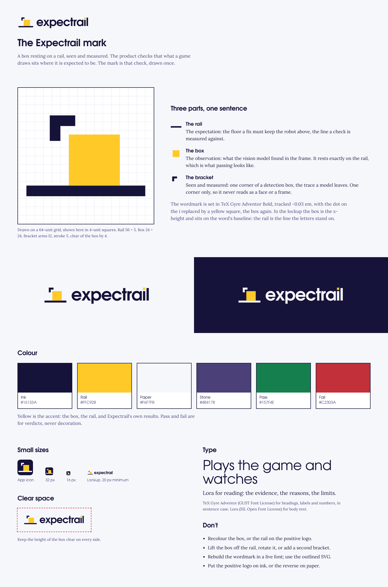

# The Expectrail mark

**A box resting on a rail, seen and measured.** Expectrail checks that what a game draws sits where
it is expected to be. The mark is that check, drawn once:

- **The rail** is the expectation: the floor a fix must keep the robot above, the line a check is
  measured against.
- **The box** is the observation: what the vision model found in the frame. It rests exactly on
  the rail, which is what passing looks like.
- **The bracket** is one corner of a detection box, the trace a model leaves: it was seen and
  measured. One corner only, so the mark never reads as a face or a picture frame.

The wordmark is `expectrail` in lower case, drawn from TeX Gyre Adventor Bold outlines, tracked
-0.03 em, with the dot on the i replaced by a yellow square: the box again. In the lockup the box
is one x-height tall and sits on the word's baseline, so the rail is the line the letters stand on.

## Files

| File | Use |
| --- | --- |
| [`expectrail-logo.svg`](expectrail-logo.svg) | The lockup, on paper or any light ground |
| [`expectrail-logo-reverse.svg`](expectrail-logo-reverse.svg) | The lockup on ink or any dark ground |
| [`expectrail-mark.svg`](expectrail-mark.svg), [`expectrail-mark-reverse.svg`](expectrail-mark-reverse.svg) | The mark alone, where the name is already said |
| [`favicon.svg`](favicon.svg) | The mark on an ink tile: browser tabs, app icons, avatars |
| [`png/`](png) | The same at 1200 px (lockups) and 512 px (mark, app icon), transparent |
| [`expectrail-brand-sheet.png`](expectrail-brand-sheet.png) | This page as one image, for slides and the video |

Every file is built by [`build_logo.py`](build_logo.py) from one construction; edit that, not the
SVGs. It needs `fontTools` and the TeX Gyre Adventor Bold OpenType file (set `ADVENTOR_BOLD_OTF`
if it isn't at the TeX Live path).

## Construction

On a 64-unit grid: the rail is 56 × 5 at y 46; the box 24 × 24 resting on it, at x 24; the bracket's
arms are 12 long and 5 thick, 4 clear of the box. In the lockup the word starts at x 72, its
x-height is 24 (the box) and its baseline is the rail's top edge.

## Colour

| Name | Hex | Use |
| --- | --- | --- |
| Ink | `#16133A` | Text, the rail on light grounds, dark panels |
| Rail | `#FFC928` | The box, the rail line on the site, Expectrail's own results |
| Paper | `#F6F7FB` | The page; the rail and bracket on dark grounds |
| Stone | `#4B4178` | Secondary text |
| Pass | `#157F4E` | "Accepted" verdicts only |
| Fail | `#C2303A` | "Rejected" verdicts only |

Contrast: ink on paper 16.5:1, stone on paper 8.4:1, white on pass 5.0:1 and on fail 5.6:1, rail on
ink 11.5:1. Rail on paper is 1.4:1, so on light grounds yellow is a shape or an underline, never
text.

## Use

- **Clear space:** the height of the box on every side.
- **Minimum size:** the lockup 20 px tall on screen; below that, use the mark or the favicon. The
  favicon holds at 16 px.
- **Type:** TeX Gyre Adventor for headings, labels and numbers, in sentence case; Lora for reading.
  Both are self-hosted on the site with their licences ([`../assets/fonts/`](../assets/fonts/README.md)).

Don't recolour the box or the rail of the positive logo, lift the box off the rail, rotate it, add
a second bracket, set the wordmark in a live font, or put the positive logo on a dark ground.
